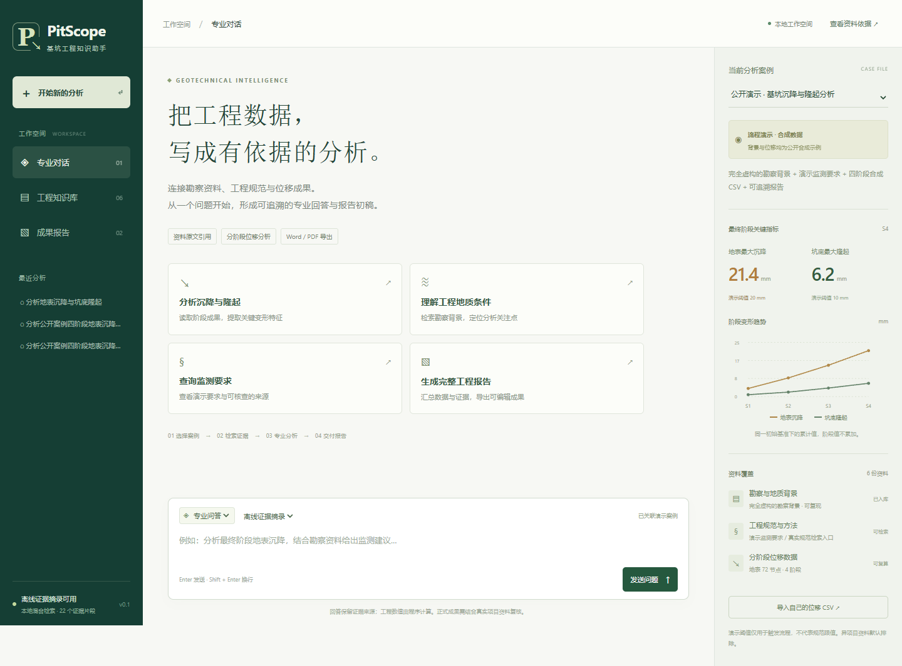
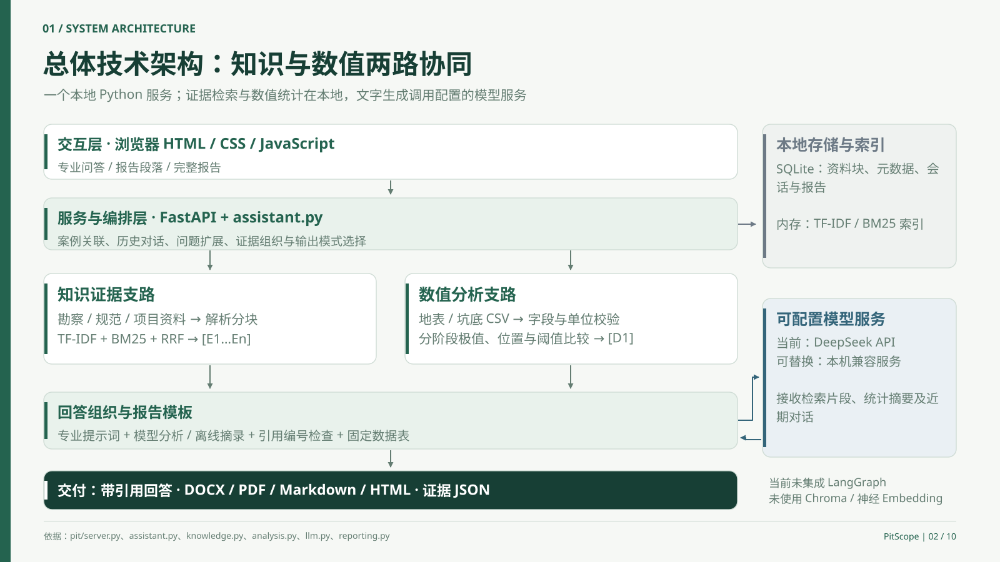
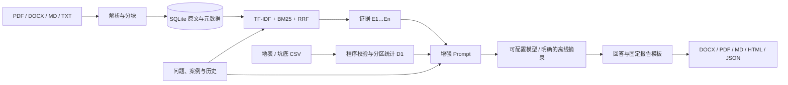
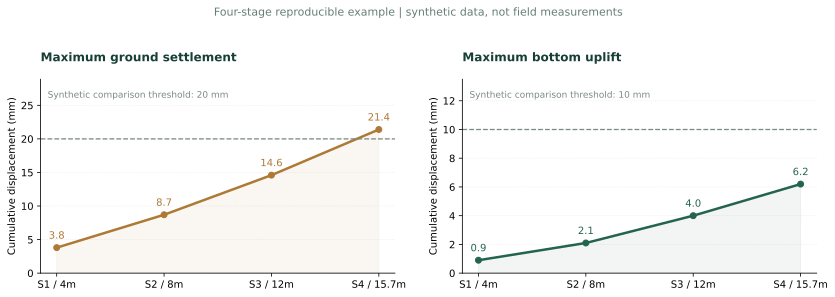
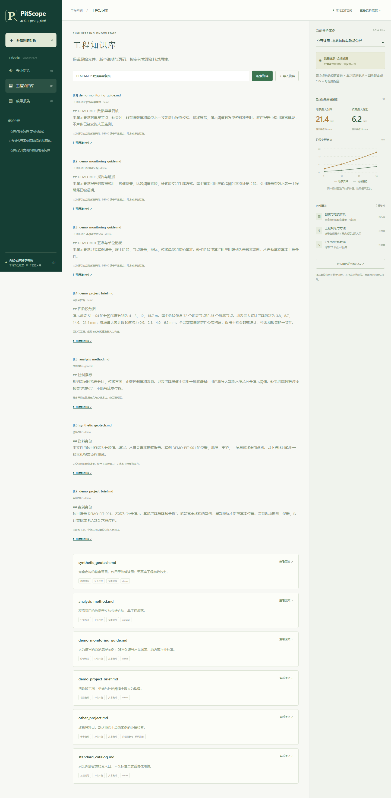
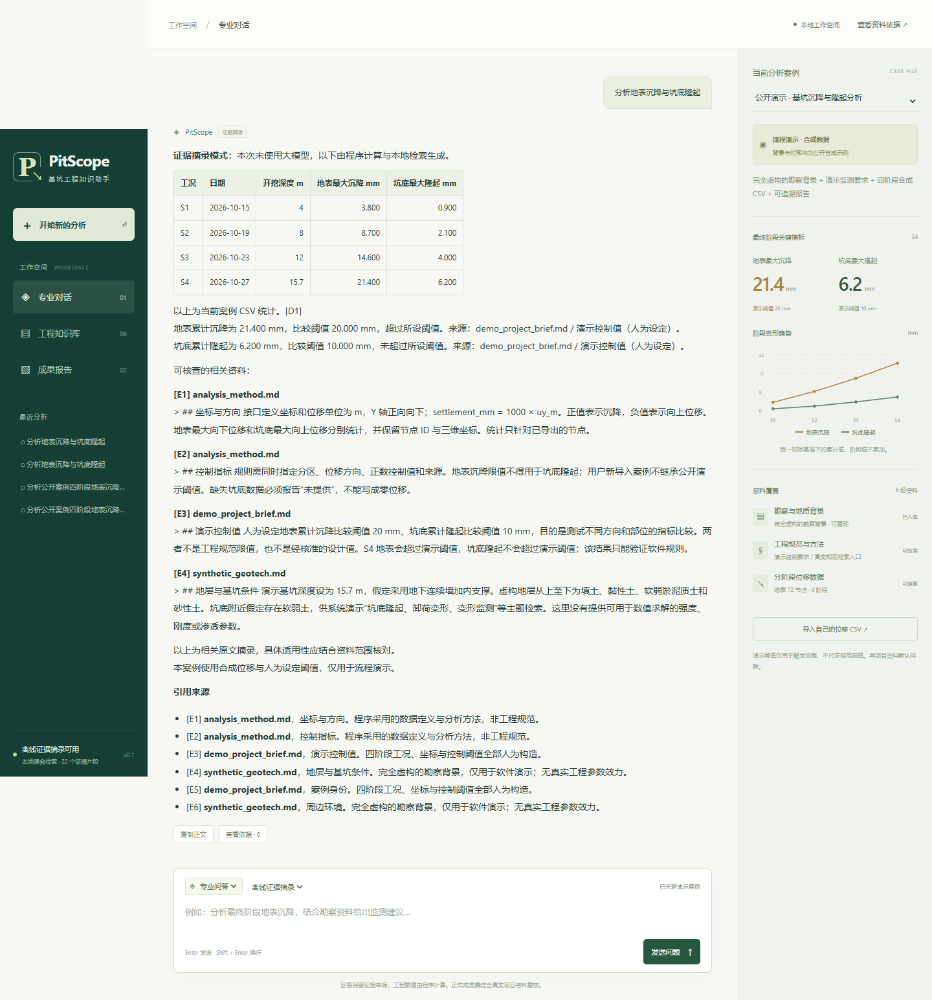
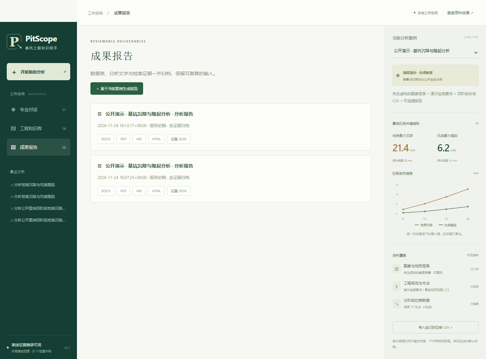

<div align="center">

# PitScope

### 基坑工程知识增强问答与成果分析系统

**Evidence-grounded answers. Deterministic engineering statistics. Reviewable reports.**

[](https://github.com/binbo6/pitscope/actions/workflows/tests.yml)


[项目案例](docs/CASE_STUDY.md) · [技术架构](docs/ARCHITECTURE.md) · [5 分钟演示](docs/DEMO.md) · [示范报告](examples/output/report.pdf) · [English](docs/README.en.md)

</div>



PitScope 将工程资料检索与位移数据分析放在同一条问答链路中。用户可以导入勘察资料、规范和节点位移 CSV，检索相关原文，获得带来源的专业回答，并导出可编辑、可复算的报告初稿。

**设计重点：数值由程序计算，分析文字结合证据生成，来源与输入一起保留。**

本公开版自带完全虚构的勘察背景、监测要求和四阶段合成位移数据。没有 API 密钥也能运行完整的“资料 → 检索 → 统计 → 报告”流程。真实勘察报告、规范全文、本机数据库和用户上传文件不在仓库中。

## 为什么做这个项目

通用文档问答通常能找到一段相关文字，但工程成果分析还需要回答：数字从哪来、对应哪个部位和工况、使用什么指标，以及结论依据是什么。

我将这个问题拆成三项可独立检查的工作：

1. **找到依据**：保留资料原文、章节、PDF 物理页码和适用范围，检索结果可回查。
2. **算对数值**：校验 CSV 字段、重复节点、非有限数值和单位，分别统计地表沉降与坑底隆起。
3. **形成成果**：模型根据证据和统计摘要撰写分析，程序组织固定表格、来源清单和多格式报告。

这是面向专业场景的轻量 RAG 与报告原型。当前没有接入上游点云处理、FLAC3D 求解或 LangGraph 编排，也没有完成真实工程预测精度评价。

## 可以体验什么

| 能力 | 实际行为 |
|---|---|
| 专业问答 / 报告段落 / 完整报告 | 三种模式共享案例上下文和检索证据 |
| 资料导入 | 支持 PDF、DOCX、Markdown、TXT；扫描件需先 OCR |
| 本地混合检索 | TF-IDF 字符稀疏向量 + BM25，使用 RRF 融合排名 |
| 案例隔离 | 当前案例与参考资料分开；切换案例后开启新对话 |
| 位移分析 | 分阶段统计地表最大向下位移、坑底最大向上位移及节点坐标 |
| 来源追溯 | `[E1]` 对应原文证据，`[D1]` 对应程序计算数据 |
| 模型与离线模式 | 支持兼容接口；未配置或调用异常时明确回退为原文摘录 |
| 多格式输出 | DOCX、PDF、Markdown、HTML，以及证据和计算 JSON |

## 快速开始

```bash
git clone https://github.com/binbo6/pitscope.git
cd pitscope
python -m venv .venv
```

Windows：

```powershell
.\.venv\Scripts\python.exe -m pip install -r requirements.txt
.\.venv\Scripts\python.exe run.py --open-browser
```

macOS / Linux：

```bash
.venv/bin/python -m pip install -r requirements.txt
.venv/bin/python run.py --open-browser
```

打开 **http://127.0.0.1:8765**。没有配置密钥时，界面会选择“离线证据摘录”。可直接点击“分析沉降与隆起”或“生成完整工程报告”。Windows 也可双击 `start.bat`；macOS / Linux 可执行 `sh start.sh`。

只生成报告，无需启动网页：

```bash
python run.py --demo --offline
```

输出位于 `deliverables/`，运行数据位于 `data/`；两者均被 Git 忽略。

## 架构与关键设计





- **检索与数值分工**：文档检索提供解释依据；CSV 通过 Python 统计，不把节点数据交给模型计算。
- **轻量索引**：SQLite 持久化原文和元数据，首次检索构建内存索引。当前 TF-IDF 是词项表示，尚未使用神经 Embedding、Chroma 或 Reranker。
- **可核查输出**：程序检查引用编号，并保留检索原文。编号有效性不等于语义正确性，工程解释仍需复核。
- **单服务运行**：FastAPI 同时提供 API 与原生 HTML/CSS/JS 界面，无需前端构建、独立向量服务或 Docker。

完整实现说明见 [ARCHITECTURE.md](docs/ARCHITECTURE.md)。

## 案例：从四阶段 CSV 到分析报告



| 阶段 | 演示开挖深度 m | 最大地表沉降 mm | 最大坑底隆起 mm |
|---|---:|---:|---:|
| S1 | 4 | 3.8 | 0.9 |
| S2 | 8 | 8.7 | 2.1 |
| S3 | 12 | 14.6 | 4.0 |
| S4 | 15.7 | 21.4 | 6.2 |

每阶段包含 72 个地表节点和 35 个坑底节点。20 mm 地表、10 mm 坑底阈值只是人为测试条件；S4 触发地表阈值提示，用于演示指标匹配和比较规则，不能形成真实工程安全结论。

直接查看：[报告 PDF](examples/output/report.pdf) · [可编辑 Word](examples/output/report.docx) · [报告正文](examples/output/report.md) · [统计 JSON](examples/output/summary.json) · [检索证据](examples/output/evidence.json) · [8 个 CSV](examples/dataset)

示范报告的实际生成方式记录在 [generation.json](examples/output/generation.json)。无密钥复现使用离线摘录模式；配置模型后可生成工程分析段落。

<details>
<summary>更多界面：资料检索、证据查看与成果报告</summary>





</details>

## 可选：接入大模型

将 `.env.example` 复制为 `.env`，填写自己的配置：

```dotenv
PIT_LLM_BASE_URL=https://api.deepseek.com
PIT_LLM_MODEL=deepseek-chat
PIT_LLM_API_KEY=your-key
```

支持本机兼容服务，例如 `PIT_LLM_BASE_URL=http://127.0.0.1:1234/v1`。本项目不会自动读取其他项目的密钥；外部配置文件需显式设置 `PIT_ENV_FILE`。

模型模式会把检索片段、计算摘要和近期对话发送至所配置的服务。离线模式不调用模型。密钥、上传文件、会话数据库和运行日志均不应提交到 Git。

## 导入自己的资料与数据

知识库界面可上传资料并选择“关联当前案例”或“参考资料”。公开版的规范目录只提供官方检索入口；真实条文需要自行取得有权使用的文本后上传。

CSV 接口约定 **Y 轴正向向下**，长度 / 位移为 m，`settlement_mm = 1000 × uy_m`：

```csv
gp_id,x_m,y_m,z_m,ux_m,uy_m,uz_m,settlement_mm
1,0,0,0,0,0.0025,0,2.5
```

地表 CSV 必选，坑底 CSV 可选。导入后创建独立案例，不继承演示控制值；缺失坑底数据会写明“未提供”。当前 UI 导入一个工况，多阶段演示由配置文件提供。

## 测试与复现

```bash
python -m pip install -r requirements-dev.txt
python -m unittest discover -s tests -v
```

当前包含 **14 项自动测试**，覆盖异常 CSV、正负方向、控制指标、资料隔离、PDF 页码、上下文、模型回退和导出接口。GitHub Actions 在 Windows / Linux、Python 3.11 / 3.12 运行测试，并上传离线报告产物。

浏览器功能检查及截图生成见 [演示说明](docs/DEMO.md)。这些测试验证软件行为，尚未测量真实项目预测误差、检索准确率或报告专家评分。

## 仓库导航

```text
pit/                 解析、检索、统计、对话与报告模块
web/                 原生浏览器界面
examples/corpus/     可公开复用的合成资料与来源目录
examples/dataset/    四阶段 CSV 和案例配置
examples/output/     可直接查看的报告、统计与证据
docs/                项目案例、架构、演示说明与截图
scripts/             案例重建与浏览器检查
tests/               独立临时目录中的自动测试
.github/workflows/   Windows / Linux 持续集成
```

## 下一步

- [x] 资料解析、混合检索、带引用对话与多格式报告
- [x] 公开合成案例、测试、来源追溯与离线复现
- [ ] 条文级结构化与检索 / 引用质量评测集
- [ ] Embedding 和 Reranker 的对照实验
- [ ] 真实 FLAC3D 结果及材料、边界、收敛元数据接口
- [ ] 专家报告评价与统一工作流工具封装

## 致谢与许可

项目设计参考 [agent-service-toolkit](https://github.com/JoshuaC215/agent-service-toolkit) 的服务化 RAG 思路，面向工程结果分析重新组织实现。感谢 FastAPI、scikit-learn、PyMuPDF、python-docx 等开源项目。

本项目代码与作者编写的合成示例采用 [AGPL-3.0](LICENSE)。第三方依赖、官方标准及用户自行导入的资料遵循各自许可和使用条件。详见 [公开数据说明](docs/PUBLIC_DATA.md)。
