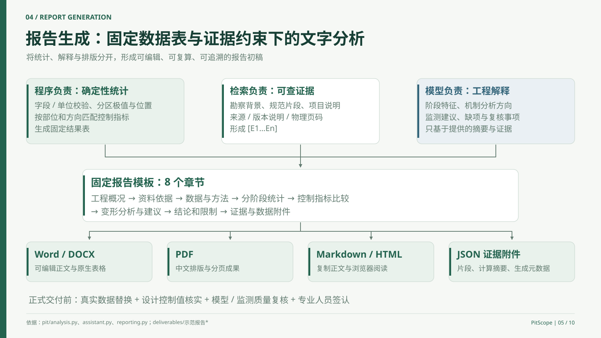

# 技术架构与实现对应

## 主链路

1. 浏览器提交问题、输出模式、案例编号和会话编号。
2. `assistant.answer()` 检查案例一致性，恢复历史，对“继续、这些”等追问补充上一问题与规范证据。
3. `knowledge.index.search()` 取得带来源的文本片段；`analysis.analyze_case()` 独立计算位移摘要。
4. `llm.generate()` 构造 system + 历史 + 问题 / 证据 / 统计 JSON，调用配置接口。
5. 程序检查引用编号，追加来源；模型异常、无配置或用户选择离线时使用明确标识的原文摘录。
6. 报告模式把分析段落与固定章节、数值表、附件结合，导出 DOCX / PDF / Markdown / HTML / JSON。

## RAG 两阶段映射

| 常见步骤 | 本项目实现 |
|---|---|
| 文档加载 | PyMuPDF、python-docx、UTF-8 文本读取 |
| 切块 | 窗口最多 880 字符，步长 720；PDF 不跨物理页 |
| 表示 | 字符 2～3 元组 TF-IDF 与 BM25 统计；无神经 Embedding |
| 保存 | SQLite 保存原文块与元数据；评分索引在内存 |
| 问题表示 | 专业词扩展 + 同一 TF-IDF 变换，追问使用前一问题辅助检索 |
| 检索 | TF-IDF 归一化点积、BM25、案例范围筛选、RRF 融合 |
| Prompt | 本次原文证据 + 问题 + 结构化统计 + 近期对话 + 工程提示词 |
| 生成 | 可配置兼容模型；程序追溯来源、渲染回答或模板报告 |

RRF 采用 `1/(40+rank_tfidf) + 1/(40+rank_bm25)`。问答默认最多 6 个片段，同一文档最多 3 个；报告模式增加地质与规范主题查询，追问可补充前一轮规范证据。当前未实现 Cross-Encoder 重排。

## 模块与职责

| 文件 | 责任 |
|---|---|
| `pit/server.py` | API、文件上传、案例导入、来源访问、导出及静态资源 |
| `pit/knowledge.py` | 文档解析、分块、哈希、SQLite、本地混合检索 |
| `pit/analysis.py` | CSV 校验、分区统计、位移方向和指标比较 |
| `pit/assistant.py` | 案例 / 历史编排、证据组织、模型回退、报告归档 |
| `pit/llm.py` | 专业提示词、统计摘要裁剪、模型调用 |
| `pit/reporting.py` | 固定报告结构、HTML 转义与四种文件格式 |
| `pit/bootstrap.py` | 无网络构造公开资料库与四阶段演示数据 |
| `pit/settings.py` | 数据目录和显式模型配置 |

## 数据与模型的分工

`settlement_mm = 1000 × uy_m`，+Y 向下。程序分别计算向下 / 向上极值和节点坐标；地表沉降规则与坑底隆起规则必须匹配方向、分区和来源。没有控制值的用户案例不比较，不从规范目录推断允许值。

LLM 负责段落解释和建议。它接收统计摘要，不接收完整节点数组；来源清单、数值表和模板章节由程序构建。现有引用检查验证编号集合，不证明生成语句忠实于证据。

## 持久化与运行边界

SQLite 保存 `documents`、`chunks`、`sessions`、`messages`、`reports`。原始上传文件与报告保存在本机运行目录。`PIT_DATA_DIR` 可设为仓库之外的目录，适合测试或独立数据存储。

当前服务默认只绑定 `127.0.0.1`，面向本机单用户使用。应用没有多租户认证、生产访问控制、OCR、实时监测采集或 FLAC3D 求解。若部署为公共服务，需要另行设计认证、文件访问和隔离。

## 技术取舍

使用 TF-IDF + BM25 是为了保持小型资料库可离线、可复现、依赖少。缺点是对措辞差异和隐含语义的识别有限。后续应通过标注问题集比较神经 Embedding、重排器和分块策略，而不是假设增加组件就必然改善效果。
