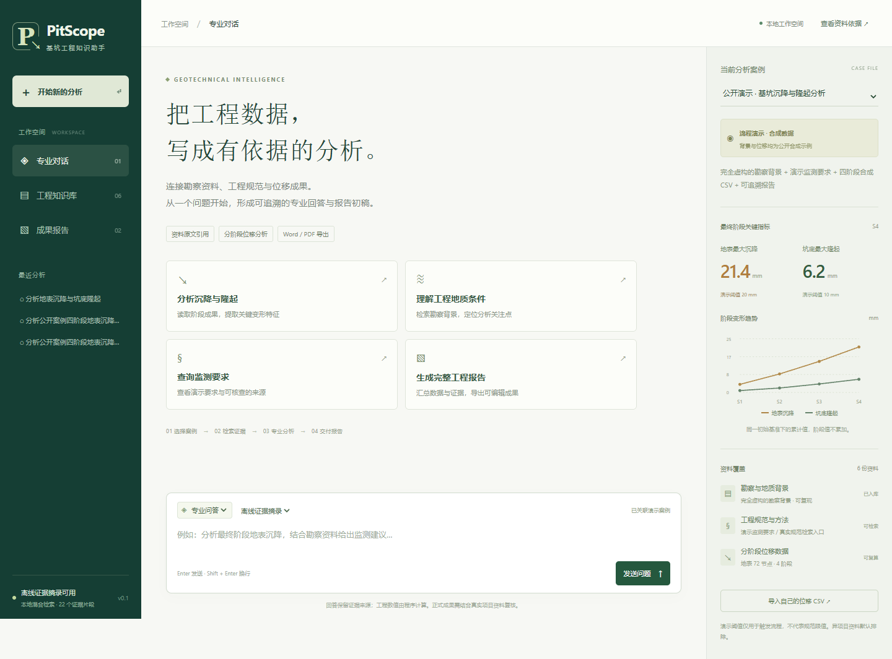

# 项目作品集：PitScope

## 项目定位

PitScope 是面向基坑沉降与隆起成果分析的专业 RAG 原型。目标是把“查资料、算指标、写分析、整理报告”连接起来，并让使用者能够回查每段证据和每项统计。

公开仓库覆盖资料到报告的分析部分；上游点云识别、重建、网格和 FLAC3D 求解属于总体研究背景，当前没有直接接入本服务。

## 我完成的工作

- 将工程知识检索与数值统计拆成独立模块，统一组织为可追溯的案例问答流程。
- 实现 PDF / Word / 文本解析、章节 / 页码元数据、本地 TF-IDF 与 BM25 混合检索及 RRF 融合。
- 实现地表 / 坑底 CSV 校验、方向判别、极值位置、指标来源和比较规则。
- 设计工程提示词、历史追问、案例范围筛选与显式离线回退。
- 实现本地交互界面、来源查看、历史对话、独立 CSV 案例和 DOCX / PDF / MD / HTML 导出。
- 为公开发布构造独立合成语料与样例，补充测试和 Windows / Linux 持续集成。

## 展示路径

**输入**：6 份作者编写的示例 / 来源目录、四阶段 CSV，每阶段 72 个地表节点与 35 个坑底节点。

**处理**：提取资料 → 原文切块 → 混合检索 → CSV 统计 → 证据与统计摘要 → 模型或离线摘录 → 固定报告。

**输出**：[报告](../examples/output/report.pdf)、[可编辑 Word](../examples/output/report.docx)、[统计 JSON](../examples/output/summary.json)、[检索证据](../examples/output/evidence.json)。生成方式见 [generation.json](../examples/output/generation.json)。

## 为什么适合工程场景

工程任务的难点不仅是“找相关段落”，还包括位移方向、工况基准、部位、指标来源以及资料是否同一项目。把这些信息保留为结构化数据，可以减少回答与原始成果脱节，并便于人工复核。

例如，坑底负位移应转为向上绝对值进行隆起统计；不能将地表沉降阈值直接套用坑底隆起，也不能把缺失坑底 CSV 当成零位移。相关行为由程序规则与自动测试检查。

## 验证与诚实边界

当前 14 项程序测试验证输入异常、方向、控制指标、资料隔离、PDF 页码、模型回退、历史和导出接口。浏览器检查覆盖桌面 / 移动布局、检索、离线回答、证据弹窗和报告下载。

四阶段沉降 3.8 / 8.7 / 14.6 / 21.4 mm，隆起 0.9 / 2.1 / 4.0 / 6.2 mm，以及 20 / 10 mm 比较阈值均为人为构造。它们用于复现软件流程，不验证真实工程预测能力。

尚未取得检索相关性、引用忠实度、专家报告评分或真实计算误差的定量结果。下一阶段应以标注问题、真实案例及专家复核开展对照实验。

## 可用于简历的项目描述

> 开发面向基坑工程资料与位移成果的 RAG 分析系统，使用 FastAPI、SQLite、TF-IDF、BM25 和 RRF 实现资料解析、混合检索及带来源问答；设计地表沉降与坑底隆起的 CSV 校验和确定性统计模块，结合可配置大模型生成工程分析，支持多格式报告与证据归档，并通过合成案例和自动测试验证核心流程。

该描述只覆盖仓库中已经实现的内容，不包含尚未完成的 LangGraph、神经向量检索或真实工程效果评价。
