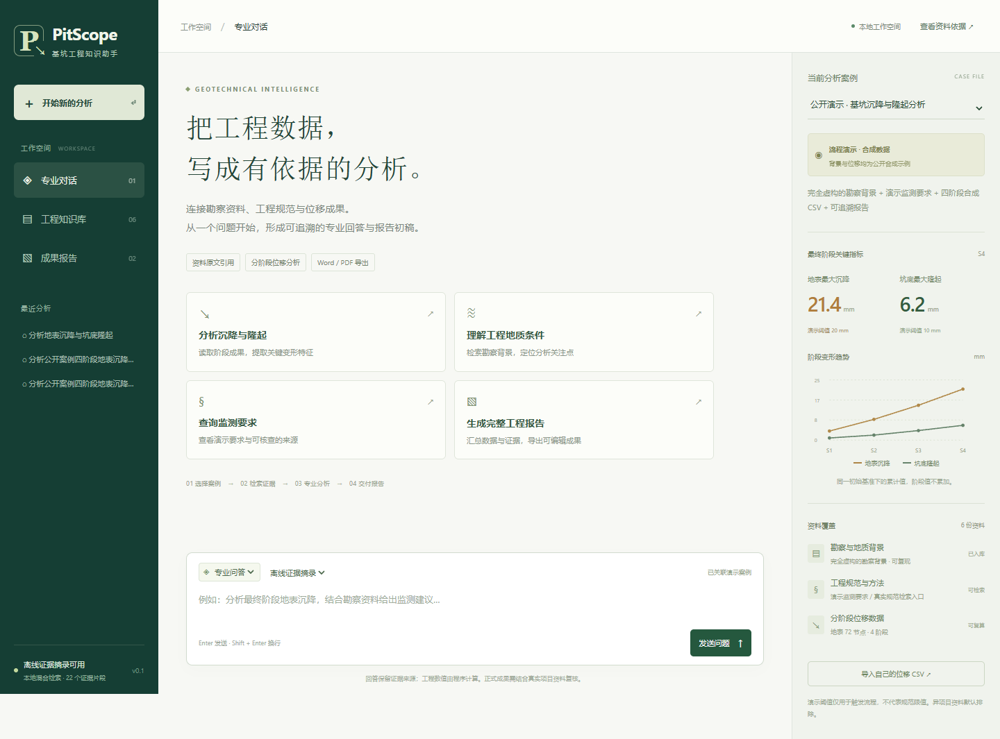

# PitScope — Evidence-grounded geotechnical RAG

[中文 README](../README.md) · [Architecture](ARCHITECTURE.md) · [Case study](CASE_STUDY.md) · [Sample report](../examples/output/report.pdf)



PitScope combines document retrieval, deterministic displacement statistics, and configurable LLM writing in one local application. It supports professional Q&A, report paragraphs, and complete reports for foundation-pit settlement and bottom uplift analysis.

## What is implemented

- PDF / DOCX / Markdown / TXT ingestion with page or section provenance.
- Character TF-IDF + BM25 retrieval fused with reciprocal rank fusion.
- SQLite persistence for documents, chunks, sessions, and reports; in-memory retrieval indexes.
- CSV validation, direction-aware regional extrema, point locations, and sourced metric comparisons.
- Case-scoped evidence, follow-up context, citation identifiers, and explicit offline fallback.
- DOCX, PDF, Markdown, HTML, and JSON outputs.
- A FastAPI service and buildless HTML/CSS/JavaScript UI.

Neural embeddings, a vector database, rerankers, LangGraph, and direct FLAC3D execution are not currently implemented. Citation-ID validation does not prove factual faithfulness.

## Run

```bash
git clone https://github.com/binbo6/pitscope.git
cd pitscope
python -m venv .venv
# Activate the environment, then:
python -m pip install -r requirements.txt
python run.py --open-browser
```

Open http://127.0.0.1:8765. No model key is required: the offline mode produces deterministic statistics and retrieved excerpts. To generate reports without starting the UI:

```bash
python run.py --demo --offline
```

For LLM writing, copy `.env.example` to `.env` and explicitly configure `PIT_LLM_BASE_URL`, `PIT_LLM_MODEL`, and `PIT_LLM_API_KEY`. Retrieved excerpts, summary data, and recent conversation are sent to that service in model mode. No sibling-project credentials are read automatically.

## Reproducible public examples

All geotechnical background, monitoring requirements, displacement data, and thresholds shipped here are fictional. Original investigation reports, third-party standards PDFs, secrets, and runtime databases are excluded. External standard references are catalog entries, not normative text.

The four-stage example ends at 21.4 mm maximum ground settlement and 6.2 mm maximum bottom uplift. The 20 / 10 mm comparison thresholds exist only to exercise software behavior. See [CSV data](../examples/dataset), [statistics](../examples/output/summary.json), and [generation metadata](../examples/output/generation.json).

## Verify

```bash
python -m pip install -r requirements-dev.txt
python -m unittest discover -s tests -v
```

Fourteen tests cover input errors, direction and metric matching, scope isolation, PDF page provenance, model fallback, conversation history, and exports. CI targets Windows / Linux with Python 3.11 / 3.12. These are functional checks, not a validated engineering forecast or retrieval-quality benchmark.

License: [AGPL-3.0](../LICENSE). Third-party materials retain their own terms.
